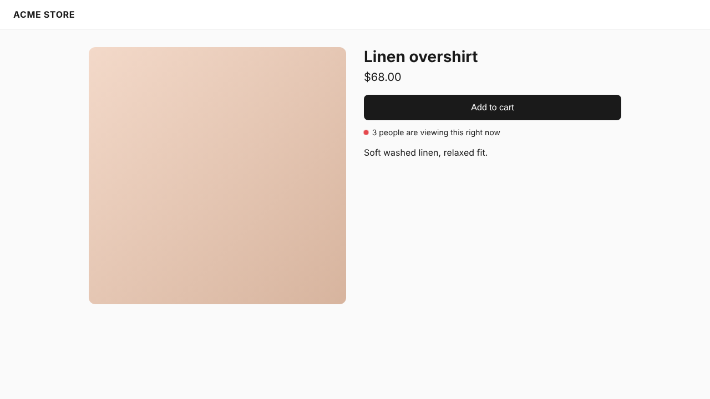
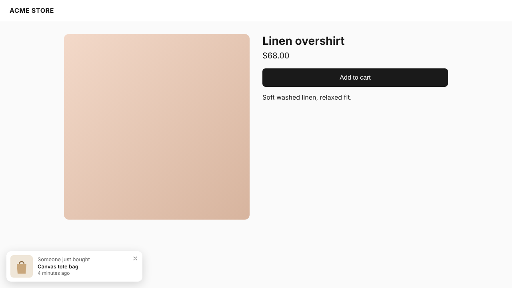
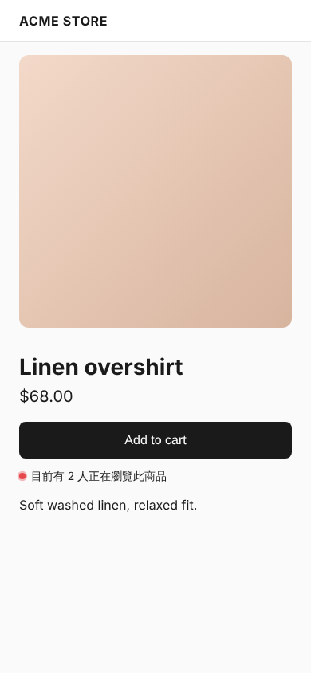

# Hibira Live Visitors for Shopify

[](https://github.com/hibira-io/shopify/actions/workflows/ci.yml)

A Shopify app that shows shoppers real social proof, counted live on
[Hibira](https://hibira.io/?utm_source=github&utm_medium=readme&utm_campaign=plugins),
a hosted realtime service that speaks the Pusher Channels protocol:

- **"3 people are viewing this right now"** on product pages. Each number is a
  real open tab on that product; it updates within a second and hides itself
  below the minimum the merchant sets (2 by default, which includes the
  shopper).
- **"Someone just bought …" popups** (Pro) from real orders, live and from
  the last 48 hours. Only the product is shown: never a customer name, place
  or order detail.
- **"12 people shopping now"** across the whole store (Pro), as a theme block.
- **Live now** in the Shopify admin: visitors on the store and the most
  viewed products, refreshed every 10 seconds.

Fake visitor counters are common on Shopify; this app never invents a number.

| Product page | Popup (Pro) | 繁體中文, phone |
|---|---|---|
|  |  |  |

Storefront text ships in English, 日本語, 繁體中文, 简体中文 and 한국어, and follows
the shopper's storefront language. Merchants can replace the wording.

## How it works

```
storefront tab ──wss──▶ Hibira ◀──HTTP API── this app ◀── Shopify webhooks
  subscribes to lv-<shop>-p-<product>      orders/create → "purchase" event
  (+ lv-<shop> on Pro)                     channels API → admin "Live now"
```

- **One Hibira app serves every shop.** Channels are named after the shop's
  myshopify subdomain: `lv-acme` (store) and `lv-acme-p-123` (product 123).
- **Counts are Hibira subscriber counts** (`pusher_internal:subscription_count`,
  sent at most once a second per channel), so there is no presence auth and
  no per-shopper data at all.
- **Page views never call this server.** The theme app embed reads its
  settings (Hibira key, plan, recent purchases) from app-data metafields that
  the app writes on install, on plan changes and on each order.
- **One small script** (`live-visitors.js`, about 6.5 KB, 2.7 KB gzipped, no
  dependencies) speaks the Pusher protocol directly. It connects only where
  there is something to show, and disconnects after 30 seconds in a
  background tab.

| Channel | Event | Sent when |
|---|---|---|
| `lv-{shop}-p-{productId}` | `pusher_internal:subscription_count` | viewers of the product change |
| `lv-{shop}` | `pusher_internal:subscription_count` | shoppers on the store change (Pro) |
| `lv-{shop}` | `purchase` `{id, title, url, image, at}` | an order is created (Pro) |

## Plans

| | Free | Pro ($9.99 / 30 days, 7-day trial) |
|---|---|---|
| "N viewing this now" on product pages | ✓ | ✓ |
| Live now in the admin | ✓ | ✓ |
| "Just bought" popups | | ✓ |
| Store-wide "N shopping now" block | | ✓ |

Billing goes through the Shopify Billing API. The price is `PRO_PRICE_USD`.

## Repository layout

| Path | What |
|---|---|
| `app/` | React Router admin app (Shopify template): routes, webhooks, billing |
| `app/live.ts` | Channel names and the recent purchase list, shared with tests |
| `app/hibira.server.ts` | Hibira HTTP client (publish, channel counts) |
| `app/store.server.ts` | App-data metafields the storefront reads |
| `extensions/live-visitors/` | Theme app extension: app embed + "Viewing now" block, locales |
| `storefront/live-visitors.js` | Source of the storefront script; `npm run build:storefront` minifies it into the extension |
| `tests/storefront/` | Renders the real Liquid blocks and runs them in Chromium |

## Develop

Needs Node 22.12+, a [Shopify Partner](https://partners.shopify.com) account
and a development store.

```shell
npm install
cp .env.example .env      # Hibira app ID, key, secret
npm run dev               # shopify app dev: links the app, tunnels, installs
```

In the Hibira console, create one app for this Shopify app and turn on
**Send subscriber counts** for it. For local work you can instead run a
Hibira server on your machine and set `HIBIRA_HOST=localhost` and
`HIBIRA_PORT=8080` (plain `ws://`).

Then in the store: **Online Store → Themes → Customize → App embeds →
Hibira Live Visitors**, or press **Open app embeds** on the app's home page.

## Test

```shell
npm test                 # unit tests and Liquid rendering
npm run test:e2e         # Chromium against a bundled mock Pusher server
HIBIRA_E2E=localhost:8080 HIBIRA_APP_ID=… HIBIRA_APP_KEY=… HIBIRA_APP_SECRET=… \
  npm run test:e2e       # the same against a real Hibira server
npm run typecheck && npm run lint && npm run build
npx @shopify/cli theme check --path extensions/live-visitors
```

The end-to-end test opens several real browser tabs on a rendered product
page and checks the count goes 1 (hidden) → 3 → 2 → 1 (hidden), that free
stores get no popups or store channel, that Pro shows the recent and a live
purchase, the store-wide block, and the Japanese and Chinese wording.

## Privacy

- Shoppers: no cookies, no IDs, nothing stored. A tab holds one WebSocket
  connection to Hibira while it is open; the popup "seen" list lives in
  `sessionStorage`.
- Merchants: the app reads orders only to learn which product was bought.
  It needs no protected customer data fields, stores no customer data, and
  answers the mandatory `customers/*` and `shop/redact` webhooks.

## Deploy

Any Node host works (`Dockerfile` included). Set the variables in
`.env.example`, with `SHOPIFY_BILLING_TEST=false`, then `npm run deploy` to
push the app configuration and theme extension to Shopify. Sessions use
Prisma with SQLite by default; switch `prisma/schema.prisma` to PostgreSQL
for more than one instance.

## License

MIT. Scaffolded from Shopify's
[React Router app template](https://github.com/Shopify/shopify-app-template-react-router).

## 中文摘要

Hibira Live Visitors 是 Shopify 應用程式，用 Hibira 的即時訂閱人數，在商品頁顯示真實的「目前有 N
人正在瀏覽此商品」，Pro 方案再加上來自真實訂單的「有人剛剛購買了…」彈窗（只顯示商品，不含任何顧客資料）
與全店「N 人正在逛商店」區塊。所有數字都是真實開著的分頁，不會造假。商店頁面不會呼叫本伺服器：設定放在 app
metafield，店面腳本約 2.7 KB（gzip）、無相依套件，背景分頁 30 秒後自動斷線。Pro 每 30 天 9.99 美元、試用 7
天，透過 Shopify Billing 收費。開發用 `npm run dev`，測試用 `npm test` 與 `npm run test:e2e`。
