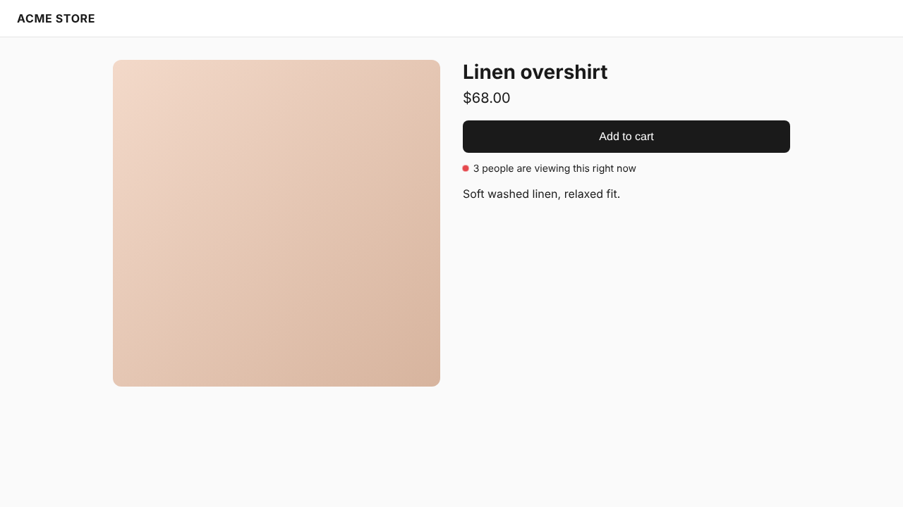
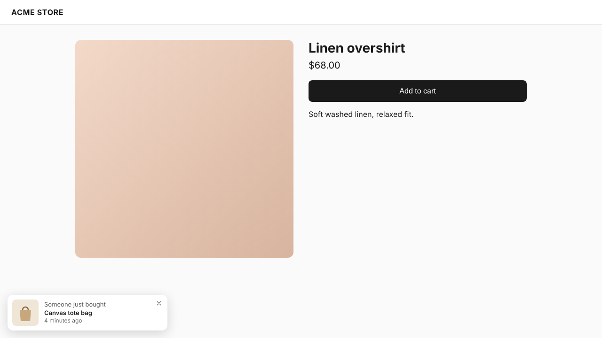
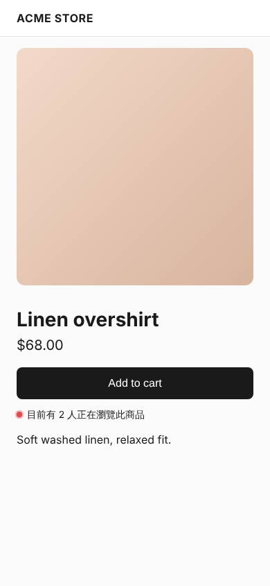

# Hibira: Chat, Visitors & Queue for Shopify

[](https://github.com/hibira-io/shopify/actions/workflows/ci.yml)

One Shopify app with three parts, all on
[Hibira](https://hibira.io/?utm_source=github&utm_medium=readme&utm_campaign=plugins):

- **Live Visitors** (below): real social proof, counted live.
- **Live Chat**: a chat button answered from the Hibira Live Chat inbox
  ([docs/live-chat.md](docs/live-chat.md)).
- **Waiting room**: a queue for drops, with a checkout rule so nobody skips
  the line ([docs/waiting-room.md](docs/waiting-room.md)).

Live Visitors shows shoppers real social proof, counted live on Hibira, a
hosted realtime service that speaks the Pusher Channels protocol:

- **"3 people are viewing this right now"** on product pages. Each number is a
  real open tab on that product; it updates within a second and hides itself
  below the minimum the merchant sets (1 by default, so a lone shopper sees
  "1 person is viewing"; the count includes the shopper).
- **"Someone just bought …" popups** (Pro) from real orders, live and from
  the last 48 hours. Only the product is shown: never a customer name, place
  or order detail.
- **"12 people shopping now"** across the whole store (Pro), as a theme block.
- **Live now** in the Shopify admin: visitors on the store and the most
  viewed products, refreshed every 10 seconds.

Fake visitor counters are common on Shopify; this app never invents a number.

| Product page | Popup (Pro) | 繁體中文, phone |
|---|---|---|
|  |  |  |

Storefront text ships in English, 日本語, 繁體中文, 简体中文 and 한국어, and follows
the shopper's storefront language. Merchants can replace the wording.

## How it works

```
storefront tab ──wss──▶ Hibira ◀── Hibira server (internal/shopify) ◀── Shopify webhooks
  subscribes to lv-<shop>-p-<product>      orders/create → "purchase" event
  (+ lv-<shop> on Pro)                     channel counts → admin "Live now"
```

- **Every shop gets its own Hibira app**, created the first time it opens
  the app, with its own limits: 100 connections on Free, 1,000 on Pro.
  Channels are named after the shop's myshopify subdomain: `lv-acme` (store)
  and `lv-acme-p-123` (product 123).
- **Counts are Hibira subscriber counts** (`pusher_internal:subscription_count`,
  sent at most once a second per channel), so there is no presence auth and
  no per-shopper data at all.
- **Page views never call this server.** The theme app embed reads its
  settings (Hibira key, plan, recent purchases) from app-data metafields that
  the app writes on install, on plan changes and on each order.
- **One small script** (`live-visitors.js`, about 6.5 KB, 2.7 KB gzipped, no
  dependencies) speaks the Pusher protocol directly. It connects only where
  there is something to show, and disconnects after 30 seconds in a
  background tab.

| Channel | Event | Sent when |
|---|---|---|
| `lv-{shop}-p-{productId}` | `pusher_internal:subscription_count` | viewers of the product change |
| `lv-{shop}` | `pusher_internal:subscription_count` | shoppers on the store change (Pro) |
| `lv-{shop}` | `purchase` `{id, title, url, image, at}` | an order is created (Pro) |

## Plans

One Shopify subscription covers all three parts, every 30 days. Paid plans
start with a 7-day trial when moving up from Free.

| | Free | Lite $9.99 | Starter $29 | Growth $99 | Business $249 |
|---|---|---|---|---|---|
| Live Visitors | Free (100 connections) | Pro (1,000) | Pro (1,000) | Pro (1,000) | Pro (3,500) |
| Live Chat | Free | Free | Starter | Team | Business |
| Waiting room | Free allowance | Free allowance | Free allowance | Drop | Launch |

Live Visitors' Pro ("just bought" popups and the store-wide block) comes
with every paid plan; stores on the old Pro ($9.99) are on Lite. A $49 event
pass buys one waiting room drop on any plan.

Billing goes through the Shopify Billing API (development stores get test
charges).

## Repository layout

This repository holds what Shopify hosts: the theme app extension and the
app's configuration. The backend (embedded admin page, billing, webhooks) is
part of the Hibira server, [hibira-io/pusher-server](https://github.com/hibira-io/pusher-server)
`internal/shopify` (see its `docs/shopify.md`), so there is no app server to
run.

| Path | What |
|---|---|
| `shopify.app.toml` | App configuration: URLs on `hibira.io/integrations/shopify`, scopes, webhooks |
| `extensions/live-visitors/` | Theme app extension: app embed + "Viewing now" block, locales |
| `extensions/live-chat-embed/` | Theme app extension: the Live Chat button's app embed |
| `extensions/waiting-room-embed/` | Theme app extension: the waiting room's app embed |
| `extensions/checkout-pass/` | The waiting room's checkout rule, a Rust Shopify Function |
| `storefront/` | Sources of the storefront scripts; `npm run build:storefront` and `npm run build:waiting-room` minify them into the extensions |
| `tests/` | Renders the real Liquid blocks and runs them (Chromium for Live Visitors) |

## Develop

Needs Node 22.12+ and access to the app in the Shopify Dev Dashboard.

```shell
npm install
npm run config:link       # once: fills client_id in shopify.app.toml
npm run dev               # theme extension preview on a development store
npm run deploy            # pushes the configuration and the extension
```

The Hibira side is set up once by an operator: in the operations console
(**Settings → Shopify**), enter the app's client ID and secret and switch
the integration on.

Then in the store: **Online Store → Themes → Customize → App embeds →
Hibira Live Visitors**, or press **Open app embeds** on the app's home page.

## Test

```shell
npm test                 # Liquid rendering
npm run test:e2e         # Chromium against a bundled mock Pusher server
HIBIRA_E2E=localhost:8080 HIBIRA_APP_ID=… HIBIRA_APP_KEY=… HIBIRA_APP_SECRET=… \
  npm run test:e2e       # the same against a real Hibira server
npm run lint
npx @shopify/cli theme check --path extensions/live-visitors
```

The end-to-end test opens several real browser tabs on a rendered product
page and checks the count goes 1 (hidden) → 3 → 2 → 1 (hidden), that free
stores get no popups or store channel, that Pro shows the recent and a live
purchase, the store-wide block, and the Japanese and Chinese wording.

## Privacy

- Shoppers: no cookies, no IDs, nothing stored. A tab holds one WebSocket
  connection to Hibira while it is open; the popup "seen" list lives in
  `sessionStorage`.
- Merchants: the app reads orders only to learn which product was bought.
  It needs no protected customer data fields, stores no customer data, and
  answers the mandatory `customers/*` and `shop/redact` webhooks.

## Deploy

`npm run deploy` releases a new app version with the configuration and the
theme extension. The backend ships with the Hibira server's releases.

CI does the same on every push to `main` that changes `shopify.app.toml` or
`extensions/` (all three parts, including the Rust checkout Function) (`.github/workflows/deploy.yml`, also runnable by hand). It
needs the repo secret `SHOPIFY_LV_APP_AUTOMATION_TOKEN`, the app's CLI automation token
(Dev Dashboard → the app → Settings); without it the deploy is skipped with a warning.

## License

MIT.

## 中文摘要

Hibira: Chat, Visitors & Queue 是一個 Shopify 應用程式，包含三個部分：Live Visitors（用 Hibira 的即時訂閱人數，在商品頁顯示真實的「目前有 N 人正在瀏覽此商品」，付費方案再加上來自真實訂單的「有人剛剛購買了…」彈窗與全店「N 人正在逛商店」區塊，數字都是真實開著的分頁，不會造假）、Live Chat（店面聊天按鈕，由 Hibira Live Chat 收件匣回覆）、等候室（開賣排隊，結帳時用 Rust Function 驗 pass）。一個 Shopify 訂閱涵蓋三者：Free、Lite $9.99、Starter $29、Growth $99、Business $249（每 30 天），另有 $49 單次活動票。舊的 Pro 訂閱自動算成 Lite。後端（嵌入式管理頁、收費、webhook）在 Hibira 伺服器（hibira-io/pusher-server 的 `internal/shopify`），本倉庫只放主題擴充、Function 與 app 設定。部署用 `npm run deploy`，或合併到 main 後由 CI 自動部署（需設定 `SHOPIFY_LV_APP_AUTOMATION_TOKEN`），測試用 `npm test` 與 `npm run test:e2e`。
